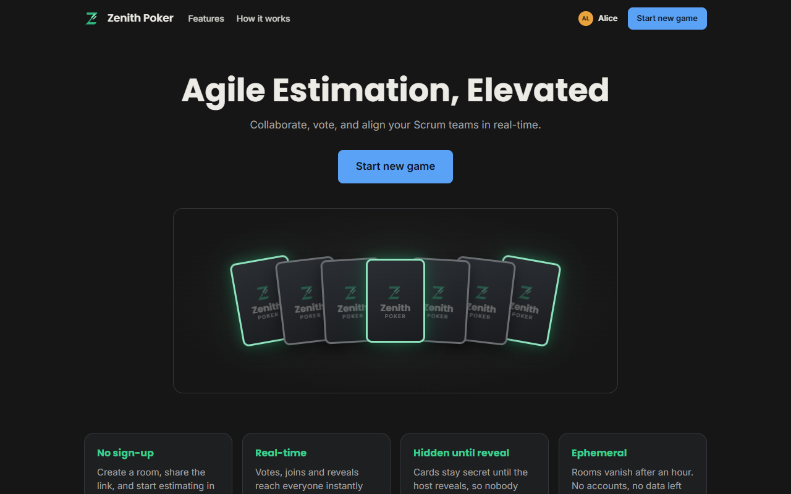
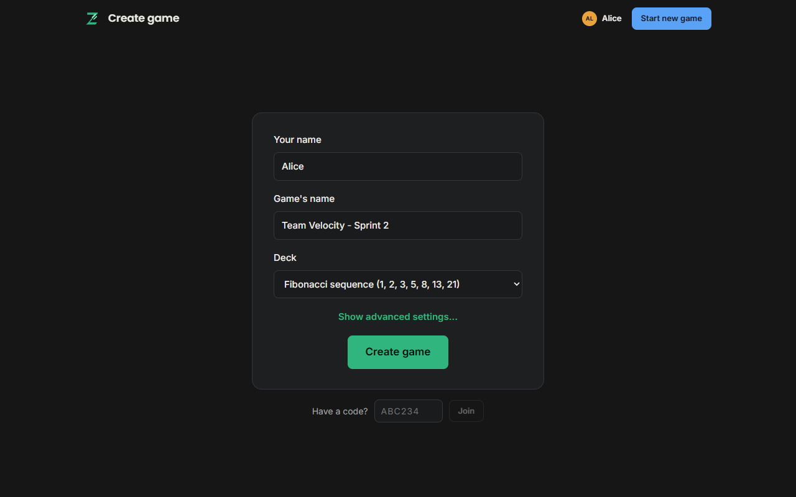
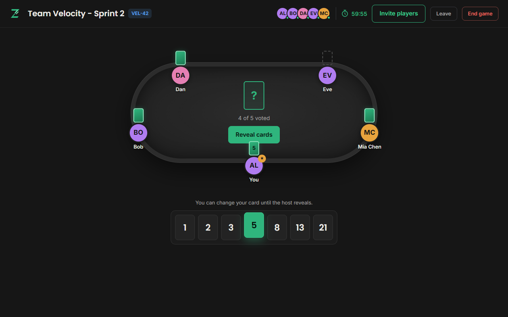
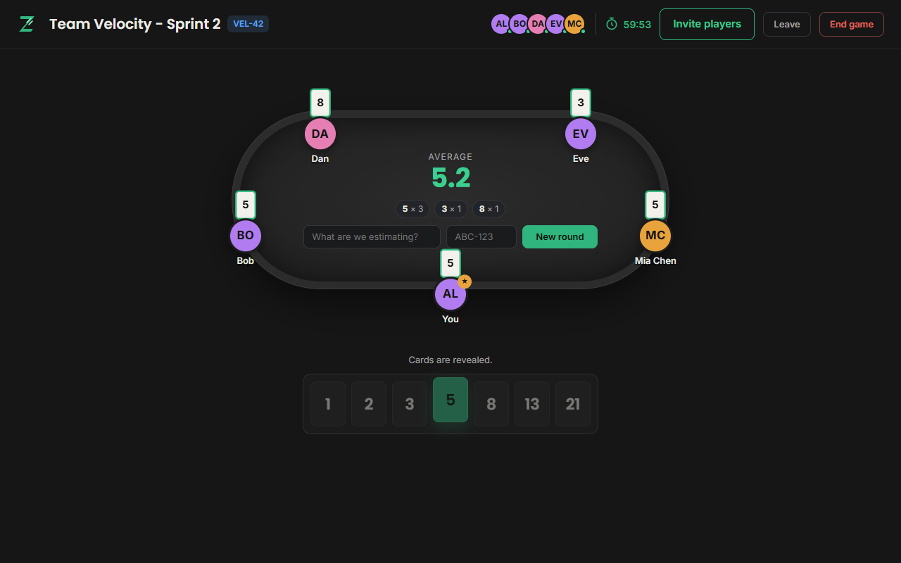

# Zenith Poker

Planning poker for Scrum teams. Create a room, share the link, vote on cards in real time and reveal together. No accounts, nothing to install.



## Features

- **No sign-up**: pick a display name and you're in. Up to 20 players per room.
- **Real-time**: joins, votes and reveals reach everyone instantly over a WebSocket.
- **Hidden until reveal**: the server never sends anyone else's card before the host reveals, so nobody anchors the team.
- **Results at a glance**: average, consensus and the vote spread for every round.
- **Host controls**: start rounds with a label and an optional Jira key, reveal, start again, or end the game. If the host leaves, the next player takes over.
- **Ephemeral**: rooms and their data are deleted after one hour.

## How it works

1. **Start a game.** Enter your name and what you're estimating. You become the host.

   

2. **Invite your team.** *Invite players* copies the room link. Teammates open it and choose a name.
3. **Vote.** Everyone picks a card from the Fibonacci deck (1, 2, 3, 5, 8, 13, 21). Other players only see *that* you voted, not what you voted.
4. **Reveal and discuss.** The host reveals every card at once, then starts the next round.

| Voting | Revealed |
|---|---|
|  |  |

## Quick start

Requires [Docker](https://docs.docker.com/get-docker/).

```sh
git clone https://github.com/CoookieSoup/AgileSCRUMPoker.git
cd AgileSCRUMPoker/backend
docker compose up -d --build --wait
```

Open <http://localhost:8091>. To stop and delete the data, run `docker compose down -v`. If you have `make`, `make up` and `make down` do the same.

| Service | URL |
|---|---|
| Web app | <http://localhost:8091> |
| API | <http://localhost:8090/api/v1> |
| MySQL | `localhost:3316` (user `poker`, password `poker`) |

## Development

To work on the frontend with hot reload, keep the compose stack running and start the dev server (Node 22+):

```sh
cd frontend
npm install
npm run dev     # http://localhost:5173, proxies /api to the backend on :8090
```

The backend needs Go 1.26+. See [backend/README.md](backend/README.md) for running it outside Docker, tests and configuration.

## Repository layout

| Path | What it is | Docs |
|---|---|---|
| [`backend/`](backend) | Go API server, MySQL storage, WebSocket event stream | [README](backend/README.md), [overview](backend/docs/overview.md), [realtime protocol](backend/docs/realtime.md), [OpenAPI](backend/api/openapi.yaml) |
| [`frontend/`](frontend) | React + TypeScript single-page app built with Vite and served by nginx | [README](frontend/README.md) |
| [`.github/workflows/`](.github/workflows) | CI: build, lint and test each part on pull requests | |

## Architecture

```text
browser ──HTTP + WebSocket──▶ nginx (web, :8091) ──/api──▶ Go server (:8090) ──▶ MySQL
```

REST calls change the room state, and the server pushes each change to everyone in the room over one WebSocket per player. The browser talks to a single origin: nginx in Docker, or the Vite dev server during development, proxies `/api` to the Go server.
